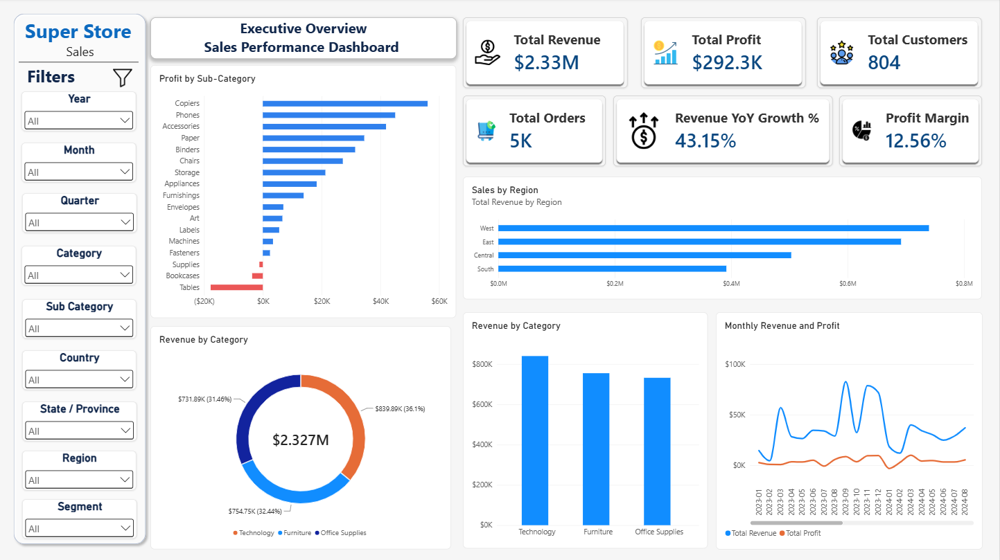
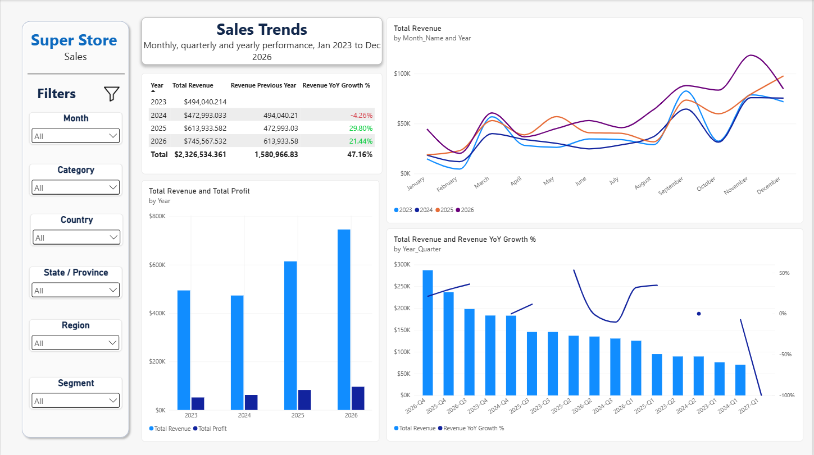
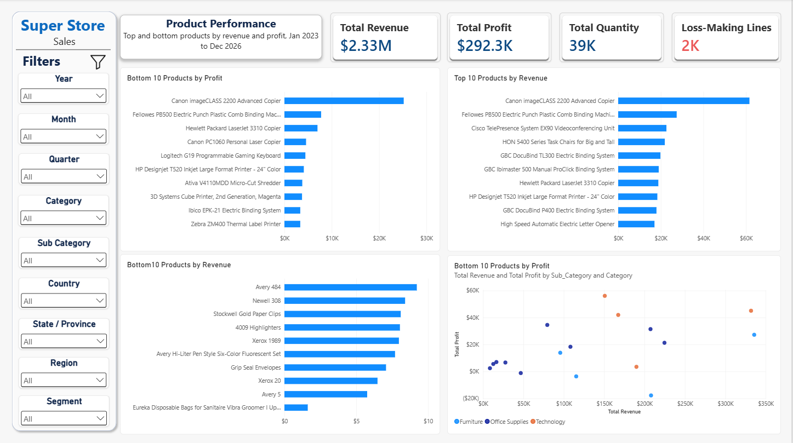
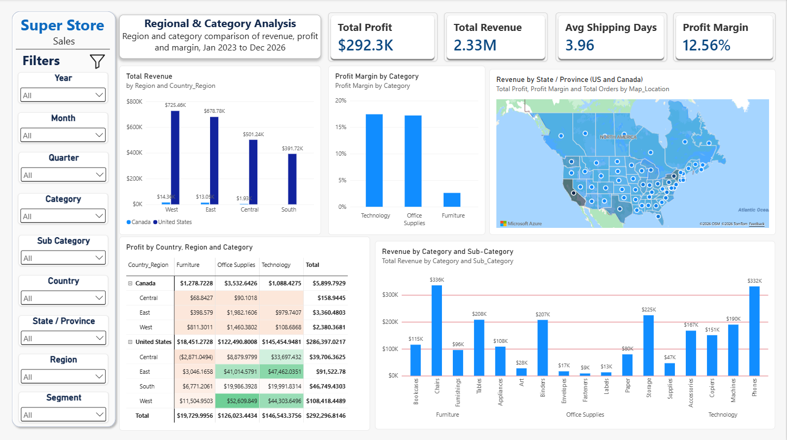

# Syntecxhub Sales Performance Dashboard

An end-to-end sales analytics project built with **Python (Jupyter), SQL Server, Power BI, Power Query and DAX**, using Tableau's public **Sample Superstore** dataset (United States and Canada, January 2023 to December 2026).

Rather than loading a CSV straight into Power BI, the project follows a professional analytics pipeline: the raw data is profiled in Python, staged and validated in SQL Server, transformed into a star-schema model, validated again, and only then analysed in an interactive four-page Power BI dashboard.

---

## Table of Contents

1. [Project Overview](#project-overview)
2. [Internship Requirements and How They Were Met](#internship-requirements-and-how-they-were-met)
3. [Dataset and Data Source](#dataset-and-data-source)
4. [Pipeline Architecture](#pipeline-architecture)
5. [Complete Project Workflow](#complete-project-workflow)
6. [Data Model](#data-model)
7. [KPIs and DAX Measures](#kpis-and-dax-measures)
8. [Power BI Dashboard Pages](#power-bi-dashboard-pages)
9. [Slicers and Interactivity](#slicers-and-interactivity)
10. [Testing and Validation](#testing-and-validation)
11. [Key Findings](#key-findings)
12. [Limitations and Notes](#limitations-and-notes)
13. [Tools and Technologies](#tools-and-technologies)
14. [Project Folder Structure](#project-folder-structure)
15. [How to Reproduce This Project](#how-to-reproduce-this-project)
16. [Author](#author)
17. [Project Status](#project-status)

---

## Project Overview

This project analyses retail sales performance for a fictional office-supplies, furniture and technology retailer. It was completed as part of the **Syntecxhub** data analytics internship.

The workflow was carried out in a structured sequence:

1. Raw data collection
2. Initial data profiling (Jupyter Notebook, Pandas)
3. SQL Server database setup and staging
4. Basic staging validation
5. Detailed data-quality checks
6. Clean dimension table creation
7. Date dimension creation
8. Sales fact table creation
9. Clean model validation
10. Power BI import (Import mode) and Power Query preparation
11. Data model, relationships and date-table configuration
12. DAX measure creation
13. Interactive dashboard development (4 pages)
14. Dashboard testing against SQL results
15. PDF and image export
16. GitHub documentation

The final Power BI report contains four pages:

| # | Page | Purpose |
|---|------|---------|
| 1 | **Executive Overview** | High-level KPIs and the main revenue/profit breakdowns |
| 2 | **Sales Trends** | Monthly, quarterly and yearly trends and growth rate |
| 3 | **Product Performance** | Top-selling and low-performing products |
| 4 | **Regional & Category Analysis** | Region, country, state/province and category comparison with a map |

> **Repository note:** Unlike many portfolio projects, this repository includes the **raw dataset** and the **Power BI `.pbix` file**. The data is public sample data with no personal information (see [Dataset and Data Source](#dataset-and-data-source)), so sharing it allows anyone to reproduce and verify every number in this project.

---

## Internship Requirements and How They Were Met

| Requirement | How it was implemented |
|---|---|
| Import and clean the raw sales dataset (remove nulls, duplicates) | Profiled in Python, staged in SQL Server, null/duplicate/invalid-value checks, clean `dim` and `fact` tables. No nulls and no exact duplicates were found, so no rows were deleted. |
| Analyze monthly, quarterly and yearly sales trends | Page 1 (monthly trend), Page 2 (seasonality by month, quarterly chart, yearly chart and growth table) |
| Identify top-selling products and low-performing items | Page 3 (Top 10 and Bottom 10 products, revenue vs profit by sub-category) and Page 1 (profit by sub-category) |
| Region-wise and category-wise sales comparison | Page 4 (region and country, category margin, region x category matrix, sub-category drill-down, map) and Page 1 |
| KPIs: total revenue, profit, growth rate | Total Revenue, Total Profit, Profit Margin, Revenue YoY Growth %, Profit YoY Growth %, Total Orders, Total Customers and more |
| Interactive dashboard in Power BI | 9 slicers, cross-filtering between visuals, drill-down, tooltips and synchronized slicers across pages |

---

## Dataset and Data Source

**Dataset:** Sample - Superstore

**Source:** Tableau Public Sample Data - https://public.tableau.com/app/learn/sample-data

**File used:** `Raw_Data/sample_superstore(csv).csv`

### Why this is a trusted resource

- **Published by Tableau.** The Superstore dataset is the official sample dataset provided by Tableau (part of Salesforce) for learning and practice. Tableau's own "Get Started" tutorial tells users to connect to Sample - Superstore, and points to the Tableau Public Sample Data page for the download ([Tableau Help: Connect to your data](https://help.tableau.com/current/guides/get-started-tutorial/en-us/get-started-tutorial-connect.htm)).
- **Industry-standard benchmark.** It is one of the most widely used datasets in analytics training, tutorials and portfolios, which means results can be compared against well-known reference analyses.
- **Structurally realistic.** It contains the fields found in real retail systems: orders and order lines, customers and segments, products with a category hierarchy, shipping, geography, discounts, sales and profit.
- **No privacy or confidentiality risk.** The customers, orders and products are fictional. The data contains no real personal information, so it is safe to publish.
- **Clean but not perfect.** Profiling showed no missing values and no duplicate rows, but it did contain realistic identifier inconsistencies (see below). That makes it a good test of a proper validation pipeline.

### Dataset structure

| Property | Value |
|---|---|
| Rows (transaction lines) | 10,194 |
| Columns | 21 |
| Unique orders | 5,111 |
| Unique customers | 804 |
| Unique products (Product ID) | 1,862 |
| Countries | 2 (United States: 9,994 rows, Canada: 200 rows) |
| Sales regions | 4 (Central, East, South, West) |
| States / provinces | 59 |
| Cities / postal codes | 542 / 654 |
| Order date range | 2023-01-03 to 2026-12-30 |
| Ship date range | 2023-01-07 to 2027-01-05 |

### Columns

| Column | Meaning | Use |
|---|---|---|
| Row ID | Unique transaction-line identifier | Fact table key |
| Order ID | Customer order (one order can have several lines) | Degenerate dimension |
| Order Date / Ship Date | Dates of order and shipment | Time analysis, shipping days |
| Ship Mode | Shipping method (4 values) | Ship Mode dimension |
| Customer ID / Customer Name / Segment | Customer identity and segment | Customer dimension |
| Country/Region, State/Province, City, Postal Code, Region | Geography | Geography dimension |
| Product ID / Product Name / Category / Sub-Category | Product and hierarchy | Product dimension |
| Sales, Quantity, Discount, Profit | Measures | Fact table |

---

## Pipeline Architecture

```
Raw Data (Tableau Sample Superstore CSV)
        |
        v
Python / Jupyter data profiling
        |
        v
SQL Server staging       -> stg.Superstore_Raw
        |
        v
Basic validation + data-quality checks
        |
        v
Clean dimensions         -> dim.Customer, dim.Product, dim.Geography, dim.Ship_Mode
Date dimension           -> dim.Date
Fact table               -> fact.Sales
        |
        v
Clean model validation (row counts, totals, orphan checks)
        |
        v
Power BI (Import mode) -> Power Query -> Star-schema model -> DAX measures
        |
        v
4-page interactive dashboard
        |
        v
Testing against SQL results -> PDF + PNG export -> GitHub
```

Key principle: **`stg.Superstore_Raw` is never modified.** All cleaning happens by creating new tables from it, so the pipeline is reproducible and every transformation is traceable.

---

## Complete Project Workflow

### Step 1: Raw Data Collection

The Sample - Superstore dataset was downloaded from the Tableau Public Sample Data page and stored, untouched, in:

```
Raw_Data/sample_superstore(csv).csv
```

The original file was never edited. All profiling and cleaning was done on copies in memory (Python) or in new SQL tables.

---

### Step 2: Initial Data Profiling (Jupyter Notebook)

A Jupyter Notebook was used for profiling before any SQL work:

```
Initial Data Profiling/
├── 01_Initial_Data_Profiling.ipynb
└── profiling_outputs/   (19 CSV summaries)
```

The notebook covered:

- Dataset size, column names and data types
- Missing values and exact duplicate rows
- Unique values per column and identifier cardinality
- **Transactional grain analysis** (lines per order)
- Customer and product identifier consistency
- Order-level consistency (customer, order date, ship date)
- Numerical quality checks (negative sales, quantity, discount range, negative profit)
- Categorical value distributions
- Date ranges and Ship Date vs Order Date validation
- Shipping duration
- Geographic fields
- Baseline business totals for later validation

#### Main profiling findings

| Area | Finding | Decision |
|---|---|---|
| Missing values | None in any column | No treatment needed |
| Exact duplicates | 0 | No rows removed |
| Grain | 10,194 lines vs 5,111 orders; 49.27% of orders have more than one line (max 14) | Keep **one row per order line**; never aggregate to order level |
| Row ID | 10,194 unique values | Used as the fact table key |
| Customer ID | Maps to exactly one name and one segment | Used as the customer business key |
| Customer Name | "Harry Olson" appears with 5 different Customer IDs | Never merge customers by name |
| Product ID | 32 Product IDs have 2 different Product Names (category and sub-category are consistent) | Standardized in `dim.Product` with a documented rule |
| Product Name | 17 names map to several Product IDs (for example "Staples") | Product ID is the product key |
| Orders | 2 orders are linked to more than one Customer ID | Flagged in the fact table, not altered |
| Profit | 1,901 negative-profit rows (18.65%) | Retained: these are real loss-making lines |
| Sales / Quantity / Discount | No negative sales, no quantity <= 0, discount always between 0 and 0.8 | Valid |
| Dates | Stored as text; no Ship Date before Order Date; shipping takes 0 to 11 days (average about 3.96) | Convert to `DATE` in SQL |
| Postal Code | Contains non-numeric Canadian codes (for example `C0A`) | Store as text |
| Future dates | Orders run to 2026-12-30 | Kept; the dataset's own range is preserved |

Baseline totals from profiling (used later to validate SQL and Power BI):

| Metric | Value |
|---|---|
| Total Sales | about 2,326,534 |
| Total Profit | about 292,297 |
| Total Quantity | 38,654 |
| Unique Orders | 5,111 |
| Unique Customers | 804 |
| Unique Products | 1,862 |

---

### Step 3: SQL Server Database Setup

**Script:** `SQL/01_database_setup.sql`

- Created the database `Syntecxhub_Sales_Performance` in SQL Server (managed through SQL Server Management Studio)
- Created the staging schema `stg`
- Created the staging table `stg.Superstore_Raw`
- Loaded the raw CSV into the staging table

---

### Step 4: Basic Staging Validation

**Script:** `SQL/02_staging_basic_validation.sql`

- Row count (10,194) and column count (21)
- Data types
- NULL counts
- Distinct Order IDs, Customer IDs and Product IDs
- Minimum and maximum Order Date, Sales and Profit

---

### Step 5: Data Quality Checks

**Script:** `SQL/03_staging_data_quality_checks.sql`
**Notes:** `SQL/staging_quality_notes.md`

- Missing values and exact duplicate rows
- Invalid values (`Sales < 0`, `Quantity <= 0`, `Discount < 0`, `Discount > 1`)
- Date validation (`Ship_Date < Order_Date`)
- Customer ID to name/segment consistency
- Product ID to name/category/sub-category consistency
- Orders linked to more than one customer
- Documentation of every decision taken and why

---

### Step 6: Clean Dimension Tables

**Script:** `SQL/04_create_clean_dimensions.sql`

Created the `dim` and `fact` schemas, then the following dimensions, each with a surrogate key, a unique constraint on the business key, and values trimmed with `LTRIM(RTRIM())`:

| Table | Grain | Rows | Notes |
|---|---|---|---|
| `dim.Customer` | One row per Customer ID | 804 | Customer_ID, Customer_Name, Segment |
| `dim.Product` | One row per Product ID | 1,862 | Includes `Product_Name_Variants` and `Product_Data_Quality_Status` |
| `dim.Geography` | One row per unique Country / Region / State / City / Postal Code | distinct combinations | Geography belongs to the transaction, not the customer |
| `dim.Ship_Mode` | One row per ship mode | 4 | First Class, Same Day, Second Class, Standard Class |

**Product name standardization rule** (documented and deterministic):

> The most frequent Product Name for a Product ID becomes the canonical name. In a tie, the alphabetically first trimmed name wins.

The 32 affected products are flagged as `Standardized_Multiple_Names`, so the treatment is visible rather than hidden. The original conflicting names remain untouched in `stg.Superstore_Raw`.

```sql
ROW_NUMBER() OVER (
    PARTITION BY [Product_ID]
    ORDER BY Name_Frequency DESC, Product_Name ASC
) AS Name_Rank
```

---

### Step 7: Date Dimension

**Script:** `SQL/05_create_date_dimension.sql`

`dim.Date` covers every calendar day from the minimum Order Date to the maximum Ship Date:

```
2023-01-03  to  2027-01-05   =   1,464 dates
```

Columns: `Date_Key` (YYYYMMDD), `Full_Date`, `Year`, `Quarter`, `Month_Number`, `Month_Name`, `Year_Month`, `Day_Number`, `Day_Name`, `Week_Number`, `Is_Weekend`.

It is generated with a recursive CTE using `OPTION (MAXRECURSION 0)`.

---

### Step 8: Sales Fact Table

**Script:** `SQL/06_create_fact_sales.sql`

Before loading the fact table, every staging row was checked against every dimension with `LEFT JOIN`s. All missing-match counts were **0**, and the joined row count matched 10,194.

`fact.Sales` preserves the **transaction-line grain**:

```
10,194 source rows  ->  10,194 fact rows
```

| Column group | Columns |
|---|---|
| Keys | `Row_ID` (primary key), `Order_ID` (degenerate dimension) |
| Foreign keys | `Order_Date_Key`, `Ship_Date_Key`, `Customer_Key`, `Product_Key`, `Geography_Key`, `Ship_Mode_Key` |
| Measures | `Sales`, `Quantity`, `Discount`, `Profit` |
| Derived | `Shipping_Days`, `Order_Customer_Anomaly_Flag` |

Integrity rules enforced by the database: a primary key on `Row_ID`, six foreign keys, and check constraints (`Sales >= 0`, `Quantity > 0`, `Discount` between 0 and 1). **There is deliberately no check on Profit**, because negative profit is a legitimate business outcome.

`Order_Customer_Anomaly_Flag = 1` marks the two orders (`CA-2025-121465` and `CA-2026-130494`) whose lines are linked to more than one Customer ID. The source Customer ID is preserved on each line; no customer was arbitrarily chosen.

---

### Step 9: Clean Model Validation

**Script:** `SQL/07_validate_clean_model.sql`

| Validation | Expected | Result |
|---|---|---|
| Staging rows | 10,194 | Passed |
| Fact rows | 10,194 | Passed |
| Unique Row IDs in fact | 10,194 | Passed |
| Unique orders in fact | 5,111 | Passed |
| `dim.Customer` rows | 804 | Passed |
| `dim.Product` rows | 1,862 | Passed |
| `dim.Ship_Mode` rows | 4 | Passed |
| `dim.Date` rows | 1,464 | Passed |
| Negative-profit rows retained | 1,901 | Passed |
| Orders flagged as customer anomalies | 2 | Passed |
| Missing dimension matches / orphan keys | 0 | Passed |
| Shipping days (min / avg / max) | 0 / about 3.96 / 11 | Passed |
| Total quantity | 38,654 | Passed |
| Total sales / total profit | about 2.3265M / about 292.3K | Passed |

---

### Step 10: Import into Power BI

Power BI Desktop connected to the SQL Server database **Syntecxhub_Sales_Performance** in **Import** mode. Only the clean model was imported (never the staging table):

```
dim_Customer   dim_Product   dim_Geography   dim_Ship_Mode   dim_Date   fact_Sales
```

---

### Step 11: Power Query Preparation

In Power Query (**Transform Data**):

- Renamed the queries to `dim_*` and `fact_Sales` so the Power BI model mirrors the SQL architecture
- Confirmed `Full_Date` as `Date` and the measures as numeric types
- Confirmed all key columns as whole numbers
- Kept `Order_Customer_Anomaly_Flag` and `Product_Data_Quality_Status`, which document the SQL data-quality treatment
- Nothing was deleted, because the cleaning was already done in SQL

---

### Step 12: Data Model and Date Table

The model is a **star schema** with six relationships (see [Data Model](#data-model)). Additional model settings:

- `dim_Date` was **marked as the date table** using `Full_Date`
- **Auto date/time was turned off**, so no hidden date tables compete with `dim_Date`
- `Month_Name` is **sorted by `Month_Number`**, so months appear January to December
- `Year`, `Quarter`, `Month_Number` and `Day_Number` set to **Don't summarize**
- Calculated columns added:

```DAX
Year_Quarter = dim_Date[Year] & "-Q" & dim_Date[Quarter]

Map_Location = dim_Geography[State_Province] & ", " & dim_Geography[Country_Region]
```

`Map_Location` (data category: Place) combines state/province with country, which removes any ambiguity for the map (for example, Washington or Georgia). It places both US states and Canadian provinces correctly.

---

### Step 13: DAX Measures

See [KPIs and DAX Measures](#kpis-and-dax-measures).

---

### Step 14: Dashboard Development

Four pages were built with a consistent design: a left filter panel with slicers, a title card, KPI cards with icons, and a consistent blue/navy/orange palette (red for losses). See [Power BI Dashboard Pages](#power-bi-dashboard-pages).

---

### Step 15: Testing

See [Testing and Validation](#testing-and-validation).

---

### Step 16: Export

- Full dashboard exported as a PDF: `Exported_Reports/Sales_Performance_Dashboard.pdf`
- Each page exported as a PNG: `Dashboard_Images/`

---

### Step 17: GitHub Documentation

The repository contains the raw data, the Power BI file, SQL scripts, the profiling notebook and its outputs, the PDF, the dashboard images, `.gitignore` and this README.

---

## Data Model

```
                         dim_Date
                        /        \
              (active) /          \ (inactive)
               Order_Date_Key    Ship_Date_Key
                      \            /
                       v          v
 dim_Customer ---->  fact_Sales  <---- dim_Product
                       ^      ^
                       |      |
              dim_Geography  dim_Ship_Mode
```

| From (one side) | To (many side) | Cardinality | Filter direction | State |
|---|---|---|---|---|
| `dim_Customer[Customer_Key]` | `fact_Sales[Customer_Key]` | 1 : * | Single | Active |
| `dim_Product[Product_Key]` | `fact_Sales[Product_Key]` | 1 : * | Single | Active |
| `dim_Geography[Geography_Key]` | `fact_Sales[Geography_Key]` | 1 : * | Single | Active |
| `dim_Ship_Mode[Ship_Mode_Key]` | `fact_Sales[Ship_Mode_Key]` | 1 : * | Single | Active |
| `dim_Date[Date_Key]` | `fact_Sales[Order_Date_Key]` | 1 : * | Single | **Active** |
| `dim_Date[Date_Key]` | `fact_Sales[Ship_Date_Key]` | 1 : * | Single | Inactive |

All time analysis uses **Order Date**. Ship Date is available as an inactive relationship for shipping analysis.

**Geography design:** `Country_Region` (United States, Canada), `State_Province`, `Region` (Central, East, South, West), `City` and `Postal_Code` all live in `dim_Geography`. `Region` is a **sales region that spans both countries**. It is not a sub-division of a country, so Canada's provinces are assigned to Region values (for example East or West).

---

## KPIs and DAX Measures

### KPI definitions

| KPI | Definition | Why it matters |
|---|---|---|
| **Total Revenue** | Sum of `Sales` across all order lines | Overall size of the business |
| **Total Profit** | Sum of `Profit` | Money actually earned after costs |
| **Profit Margin** | Total Profit / Total Revenue | How much profit each dollar of sales produces |
| **Total Orders** | Distinct count of `Order_ID` | Number of customer orders. A plain row count would overcount, because one order can have up to 14 lines |
| **Total Customers** | Distinct count of `Customer_Key` | Size of the customer base |
| **Total Quantity** | Sum of `Quantity` | Units sold (volume) |
| **Average Order Value** | Total Revenue / Total Orders | Typical spend per order |
| **Revenue YoY Growth %** | (Revenue - Revenue in the same period last year) / Revenue in the same period last year | **Growth rate**: how revenue changes year over year |
| **Profit YoY Growth %** | Same logic applied to profit | Whether profit grows with revenue |
| **Avg Discount** | Average of `Discount` | Pricing pressure |
| **Avg Shipping Days** | Average of `Shipping_Days` (Ship Date minus Order Date) | Fulfilment speed |
| **Loss-Making Lines** | Count of order lines where `Profit < 0` | How many sales lose money |

### DAX measures

```DAX
Total Revenue = SUM(fact_Sales[Sales])

Total Profit = SUM(fact_Sales[Profit])

Total Quantity = SUM(fact_Sales[Quantity])

Total Orders = DISTINCTCOUNT(fact_Sales[Order_ID])

Total Customers = DISTINCTCOUNT(fact_Sales[Customer_Key])

Average Order Value =
DIVIDE( [Total Revenue], [Total Orders] )

Profit Margin =
DIVIDE( [Total Profit], [Total Revenue] )

Revenue Previous Year =
CALCULATE( [Total Revenue], SAMEPERIODLASTYEAR( dim_Date[Full_Date] ) )

Revenue YoY Growth % =
DIVIDE( [Total Revenue] - [Revenue Previous Year], [Revenue Previous Year] )

Profit Previous Year =
CALCULATE( [Total Profit], SAMEPERIODLASTYEAR( dim_Date[Full_Date] ) )

Profit YoY Growth % =
DIVIDE( [Total Profit] - [Profit Previous Year], [Profit Previous Year] )

Avg Discount = AVERAGE(fact_Sales[Discount])

Avg Shipping Days = AVERAGE(fact_Sales[Shipping_Days])

Loss-Making Lines =
CALCULATE( COUNTROWS(fact_Sales), fact_Sales[Profit] < 0 )
```

> `DIVIDE()` is used instead of `/` so that a zero or blank denominator returns blank instead of an error. The data starts in 2023, so **YoY growth is blank for 2023**: there is no 2022 to compare against.

---

## Power BI Dashboard Pages

Every page shares the same left filter panel, title card and visual style. Figures quoted in the interpretations come from the dashboard with no slicers applied.

---

### Page 1: Executive Overview

A high-level summary of the whole business.



#### KPI cards

| KPI | Value (all data) |
|---|---|
| Total Revenue | $2.33M |
| Total Profit | $292.3K |
| Total Customers | 804 |
| Total Orders | 5,111 |
| Profit Margin | 12.56% |
| Revenue YoY Growth % | Meaningful when a single year is selected (blank for 2023) |

#### Slicers

Year, Month, Quarter, Category, Sub Category, Country, State / Province, Region, Segment.

#### Visuals

**1. Profit by Sub-Category** (bar chart; red bars are losses)
- *Fields:* Y-axis `Sub_Category`, X-axis `Total Profit`, sorted descending, conditional color (red below 0)
- *What it shows:* Profit for each of the 17 sub-categories. Copiers (about $56K), Phones (about $45K) and Accessories (about $42K) lead. Tables (about -$18K), Bookcases and Supplies are negative.
- *What it means:* Profit is concentrated in a few technology and office-supply sub-categories, while three sub-categories lose money. Tables is the largest single loss and is a priority for pricing and discount review.

**2. Sales by Region** (bar chart)
- *Fields:* Y-axis `Region`, X-axis `Total Revenue`
- *What it shows:* West is the largest region (about $0.74M), followed by East (about $0.69M), Central (about $0.50M) and South (about $0.39M).
- *What it means:* West and East together produce about 62% of revenue. South is the smallest market and the clearest growth opportunity.

**3. Revenue by Category** (donut chart)
- *Fields:* Legend `Category`, Values `Total Revenue`
- *What it shows:* Technology $839.89K (36.1%), Furniture $754.75K (32.44%), Office Supplies $731.89K (31.46%).
- *What it means:* Revenue is split almost evenly across the three categories, so the business is not dependent on a single one. Revenue share alone, however, hides large differences in profitability (see Page 4).

**4. Revenue by Category** (column chart)
- *Fields:* X-axis `Category`, Y-axis `Total Revenue`
- *What it shows:* The same categories as absolute dollar values.
- *What it means:* Technology leads Furniture by about $85K and Office Supplies by about $108K. Together with the donut, this shows both the amounts and the shares.

**5. Monthly Revenue and Profit** (line chart)
- *Fields:* X-axis `Year_Month`, Y-axis `Total Revenue` and `Total Profit`
- *What it shows:* Month-by-month revenue (blue) and profit (orange) from January 2023 to December 2026.
- *What it means:* Revenue is volatile, with clear peaks in autumn and winter, while profit stays low and flat by comparison and occasionally dips to around zero. Revenue spikes therefore do not translate proportionally into profit.

#### Conclusion

- The business generated **$2.33M in revenue** and **$292.3K in profit** from **5,111 orders** and **804 customers**, at an overall **profit margin of 12.56%**.
- Revenue is balanced across categories, but profit is not: a few sub-categories drive most of the profit, while Tables, Bookcases and Supplies lose money.
- The West and East regions dominate sales.
- Revenue is strongly seasonal, and profit does not move as much as revenue.

---

### Page 2: Sales Trends

Compares performance over time, using all years together.



#### KPIs

This page has no KPI cards: the charts and the growth table carry the message. The **growth rate** requirement is covered by the Yearly Growth Table.

#### Slicers

Month, Category, Country, State / Province, Region, Segment. **Year and Quarter slicers are intentionally omitted**, because this page compares all years side by side.

#### Visuals

**1. Yearly Growth Table** (matrix)
- *Fields:* Rows `Year`, Values `Total Revenue`, `Revenue Previous Year`, `Revenue YoY Growth %` (negative growth in red, positive in green)
- *What it shows:*

| Year | Total Revenue | YoY Growth |
|---|---|---|
| 2023 | $494,040 | blank (no 2022 data) |
| 2024 | $472,993 | -4.26% |
| 2025 | $613,934 | +29.80% |
| 2026 | $745,568 | +21.44% |

- *What it means:* Revenue dipped slightly in 2024, then recovered strongly in 2025 and kept growing in 2026. Each year after 2024 is higher than the one before. The Total row is a combined comparison and is not a true annual growth rate, so the individual years should be used.

**2. Total Revenue and Total Profit by Year** (clustered column chart)
- *Fields:* X-axis `Year`, Y-axis `Total Revenue` and `Total Profit`
- *What it shows:* Yearly revenue and profit side by side.
- *What it means:* Profit grew every year, including 2024 when revenue fell, which shows that profitability improved even in the weakest sales year. Profit remains a small fraction of revenue throughout.

**3. Seasonality: Total Revenue by Month and Year** (line chart, one line per year)
- *Fields:* X-axis `Month_Name` (sorted by `Month_Number`), Y-axis `Total Revenue`, Legend `Year`
- *What it shows:* The monthly revenue pattern for 2023 to 2026 on the same axis.
- *What it means:* The four years follow the same shape: low revenue in January and February, a rise in March, a dip in October, and the strongest months in September, November and December. 2026 reaches the highest point of all four years (November). This is a stable seasonal pattern that can support inventory and staffing planning.

**4. Total Revenue and Revenue YoY Growth % by Quarter** (combo chart: columns plus line)
- *Fields:* X-axis `Year_Quarter`, Column `Total Revenue`, Line `Revenue YoY Growth %`
- *What it shows:* Quarterly revenue with its year-over-year growth.
- *What it means:* Q4 is the strongest quarter every year (about $184K in 2023 and 2024, $238K in 2025 and $287K in 2026), and Q1 is the weakest (about $77K, $71K, $96K and $125K). Growth is blank for 2023 quarters because they have no prior year.

#### Conclusion

- Revenue grew from **$494K (2023)** to **$746K (2026)**, a rise of about **51%** over the period, despite a **-4.26% dip in 2024**.
- **2025 (+29.80%)** and **2026 (+21.44%)** show strong, consistent growth.
- Profit rose every year, so profitability improved even when revenue fell.
- Seasonality is strong and repeatable: **Q4 is the peak** and **Q1 the low point**, with Q3 and November-December driving the highest months.

---

### Page 3: Product Performance

Identifies top-selling and low-performing products.



#### KPI cards

| KPI | Value (all data) |
|---|---|
| Total Revenue | $2.33M |
| Total Profit | $292.3K |
| Total Quantity | 38,654 units |
| Loss-Making Lines | 1,901 (18.65% of 10,194 lines) |

#### Slicers

Year, Month, Quarter, Category, Sub Category, Country, State / Province, Region, Segment.

#### Visuals

**1. Top 10 Products by Revenue** (bar chart with a Top N filter)
- *Fields:* Y-axis `Product_Name`, X-axis `Total Revenue`, filter: Top 10 by `Total Revenue`
- *What it shows:* The ten highest-revenue products. The Canon imageCLASS 2200 Advanced Copier leads with about $61K, followed by the Fellowes PB500 binding machine (about $27K) and the Cisco TelePresence EX90 (about $22K).
- *What it means:* Top sellers are mostly high-priced equipment: copiers, binding machines, printers and a conferencing system. A single product (the Canon copier) produces about 2.6% of all revenue.

**2. Top 10 Products by Profit** (bar chart with a Top N filter)
- *Fields:* Y-axis `Product_Name`, X-axis `Total Profit`, filter: Top 10 by `Total Profit`
- *What it shows:* The ten most profitable products. The Canon imageCLASS 2200 earns about $25K, roughly three times the next product (Fellowes PB500, about $8K).
- *What it means:* Profit is highly concentrated. The Canon copier alone accounts for roughly 8% to 9% of total profit, so the supply, price and availability of this single product matter a great deal.

**3. Bottom 10 Products by Revenue** (bar chart with a Bottom N filter)
- *Fields:* Y-axis `Product_Name`, X-axis `Total Revenue`, filter: Bottom 10 by `Total Revenue`
- *What it shows:* The ten lowest-revenue products, all below about $10 in total sales (for example Avery 484, Newell 308, Stockwell Gold Paper Clips).
- *What it means:* The weakest products are low-priced stationery consumables. They add almost nothing to revenue, so they are candidates for range review, bundling or removal.

**4. Revenue vs Profit by Sub-Category** (scatter chart; color shows the category)
- *Fields:* Values `Sub_Category`, X-axis `Total Revenue`, Y-axis `Total Profit`, Legend `Category`
- *What it shows:* Each dot is a sub-category. Higher and further right is better; any dot below the zero line loses money.
- *What it means:* High revenue does not guarantee profit:
  - **Tables** (about $208K revenue) lose about $18K, and **Bookcases** also lose money.
  - **Machines** (about $190K revenue) earn only about $3K.
  - **Copiers, Phones and Accessories** combine strong revenue with strong profit.

#### Conclusion

- **Top performers** are high-value technology and office equipment, led by the Canon imageCLASS 2200 copier.
- **Low performers** by revenue are cheap stationery consumables with a negligible sales contribution.
- **1,901 order lines (18.65%) lose money**, so loss-making sales are a significant issue and not just noise.
- The most important insight is that **revenue and profit tell different stories**: Tables and Machines sell heavily but earn little or lose money, and should be investigated for pricing and discounting.

---

### Page 4: Regional & Category Analysis

Compares regions, countries, states/provinces and categories. The dataset covers **two countries, the United States and Canada**, and this page is designed to show both.



#### KPI cards

| KPI | Value (all data) |
|---|---|
| Total Profit | $292.3K |
| Total Revenue | $2.33M |
| Avg Shipping Days | 3.96 |
| Profit Margin | 12.56% |

#### Slicers

Year, Month, Quarter, Category, Sub Category, Country, State / Province, Region, Segment. The **Country** slicer lets the viewer isolate Canada or the United States, and the map zooms to the selection.

#### Visuals

**1. Total Revenue by Region and Country** (clustered column chart)
- *Fields:* X-axis `Region`, Y-axis `Total Revenue`, Legend `Country_Region`
- *What it shows:* Revenue for each of the four regions, split between the United States and Canada. Canada appears only in West ($14.36K), East ($13.05K) and Central ($1.93K).
- *What it means:* The United States generates about **98.7%** of revenue. Canada contributes roughly 1.3% and has no sales in the South region. The regional ranking (West, East, Central, South) is driven almost entirely by US sales.

**2. Profit Margin by Category** (column chart)
- *Fields:* X-axis `Category`, Y-axis `Profit Margin`
- *What it shows:* Technology at about 17.4%, Office Supplies at about 17.2% and Furniture at only about 2.6%.
- *What it means:* **Furniture is by far the least profitable category.** It produces 32% of revenue but only about 7% of profit, whereas Technology produces 36% of revenue and about 50% of profit.

**3. Revenue by State / Province** (Azure Maps filled map)
- *Fields:* Location `Map_Location` (state/province plus country), Color `Total Revenue`, Tooltips `Total Profit`, `Profit Margin`, `Total Orders`
- *What it shows:* Revenue intensity for every US state and Canadian province. Hovering over a location shows its profit, margin and order count, and clicking one filters the whole page.
- *What it means:* Sales are concentrated in a few large states. This matches profiling, where California (2,001 lines), New York (1,128) and Texas (985) have the most transaction lines. Canadian provinces look pale next to US states because Canada represents only 200 of the 10,194 lines. Selecting **Canada** in the Country slicer lets the provinces be compared among themselves.

**4. Profit by Country, Region and Category** (matrix with a red-to-green color scale)
- *Fields:* Rows `Country_Region` then `Region`, Columns `Category`, Values `Total Profit`
- *What it shows:* Profit for every country, region and category combination.
- *What it means:*
  - The strongest cells are **West / Office Supplies ($52.6K)**, **East / Technology ($47.5K)** and **West / Technology ($44.3K)**.
  - **US Central / Furniture is a loss (-$2.9K)**, the only negative cell.
  - By region, **West** earns the most profit ($108K US plus $2K Canada), followed by East, South and Central.
  - Canada earns $5.9K profit in total, which is a margin of roughly 20%, though on a small sample of 200 lines.

**5. Revenue by Category and Sub-Category** (column chart with a Category to Sub-Category hierarchy)
- *Fields:* X-axis `Category` then `Sub_Category`, Y-axis `Total Revenue`
- *What it shows:* Revenue for all 17 sub-categories grouped under their category. The hierarchy supports drill-down and drill-up.
- *What it means:* Chairs ($336K) and Phones ($332K) are the top revenue sub-categories, followed by Storage ($225K) and Tables ($208K). Fasteners, Labels and Envelopes sell the least ($9K to $17K). Note that Tables ranks fourth in revenue but loses money (see Page 3).

#### Conclusion

- Sales are almost entirely **US-based (about 98.7%)**. Canada is a very small market, but its margin looks healthy.
- **West** is the best region for both revenue and profit. **Central** is the weakest in margin (roughly 8%, against roughly 15% for West), and it is the only region with a loss-making cell (Furniture).
- **Technology and Office Supplies** earn margins of around 17%, but **Furniture earns only about 2.6%**, held back mostly by Tables and Bookcases.
- Shipping is fast and consistent, at an average of **3.96 days**.

---

## Slicers and Interactivity

| Feature | Description |
|---|---|
| **Slicers** | Dropdown slicers for Year, Month, Quarter, Category, Sub Category, Country, State / Province, Region and Segment on Pages 1, 3 and 4. Page 2 omits Year and Quarter. |
| **Slicer synchronization** | Slicers are synced across pages, so choosing a filter on one page applies to the others |
| **Cross-filtering** | Clicking a bar, slice, matrix cell or map location filters the other visuals on the page |
| **Drill-down** | Category to Sub-Category hierarchy on Page 4 |
| **Tooltips** | The map shows profit, margin and orders on hover |
| **Top N / Bottom N filters** | Top 10 and Bottom 10 products on Page 3. They recalculate inside any slicer selection. |
| **Conditional formatting** | Red for losses in bars and the growth table; red-to-green color scale in the profit matrix |

---

## Testing and Validation

The dashboard was tested against the SQL results with every slicer cleared.

### KPI validation: SQL vs Power BI

| Metric | SQL result | Power BI | Match |
|---|---|---|---|
| Total Revenue | about 2,326,534 | $2.33M (yearly table total: $2,326,534.361) | Yes |
| Total Profit | about 292,297 | $292.3K (matrix total: $292,296.8146) | Yes |
| Total Quantity | 38,654 | 38,654 | Yes |
| Total Orders | 5,111 | 5,111 | Yes |
| Total Customers | 804 | 804 | Yes |
| Loss-Making Lines | 1,901 | 1,901 | Yes |
| Avg Shipping Days | about 3.96 | 3.96 | Yes |

The country split was also checked in SQL:

```sql
SELECT g.Country_Region,
       SUM(f.Sales)  AS Total_Sales,
       SUM(f.Profit) AS Total_Profit,
       COUNT(DISTINCT f.Order_ID) AS Orders
FROM fact.Sales f
JOIN dim.Geography g ON g.Geography_Key = f.Geography_Key
GROUP BY g.Country_Region;
```

### Functional tests

- Every slicer changes all relevant visuals
- Slicer selections carry across pages
- Clicking visuals cross-filters the rest of the page
- Drill-down shows the correct sub-categories
- Top N and Bottom N filters recalculate within slicer selections
- Month names appear in calendar order (sorted by `Month_Number`)
- Percentages are formatted as percentages, and negative growth is red
- Map displays both US states and Canadian provinces
- Selecting Canada zooms the map and updates every visual
- No overlapping visuals; spacing and alignment are consistent across pages

---

## Key Findings

- **$2.33M revenue, $292.3K profit, 12.56% margin** across **5,111 orders** and **804 customers**, an average of about **$455 per order**.
- **Revenue grew strongly after a dip in 2024**: -4.26% (2024), +29.80% (2025), +21.44% (2026). Profit rose every year.
- **Strong, repeatable seasonality:** Q4 is the peak and Q1 the low point in every year, and September, November and December are the strongest months.
- **Revenue is balanced across categories** (Technology 36%, Furniture 32%, Office Supplies 31%), but **profit is not:** Technology produces about 50% of profit and Furniture only about 7%.
- **Furniture's weakness is driven by Tables (about -$18K) and Bookcases.** Machines is another sub-category with high revenue and almost no profit.
- **18.65% of order lines (1,901) are loss-making.**
- **The West region leads** on revenue and profit, **Central** has the lowest margin, and **South** is the smallest market.
- **The United States generates about 98.7% of revenue.** Canada is small, but both countries are fully supported in the dashboard.
- **Product performance is concentrated:** one copier (Canon imageCLASS 2200) accounts for roughly 8% to 9% of profit.

> Values may vary slightly depending on active slicers and display rounding.

---

## Limitations and Notes

- **Synthetic data.** Superstore is Tableau's fictional sample dataset. The findings illustrate the analysis method and are not real business results.
- **Future-dated records.** Order dates run to 30 December 2026, and ship dates to 5 January 2027, which is later than the date the project was built. This is how the downloaded version of the dataset is dated. The data was kept as supplied, and `dim_Date` covers the full range.
- **Product name inconsistencies.** 32 Product IDs have two different product names in the source. They were standardized using a documented rule and flagged in `dim.Product`. Visuals that group by Product Name combine the 17 names that are shared by several Product IDs (such as "Staples").
- **Order/customer anomalies.** Two orders are linked to more than one customer. They are flagged in the fact table (`Order_Customer_Anomaly_Flag`) and not altered.
- **YoY growth is blank for 2023.** There is no 2022 data to compare against. When no single year is selected, the YoY card shows a blended comparison, so a year should be selected (or the Yearly Growth Table used) for a clean reading.
- **Canada is a small sample** (200 of 10,194 lines), so country-level comparisons should be interpreted with caution.
- **Postal codes were not used on the map.** There are 654 values, and the Canadian ones are partial codes (such as `C0A`) that map poorly. State/province plus country is used instead.
- **Power BI file and refresh.** The `.pbix` uses **Import** mode. It opens and is fully interactive without any setup, but clicking **Refresh** requires the SQL Server database created by the scripts in `SQL/`.
- **Map visuals** use Azure Maps and need an internet connection and the "Use Map and Filled Map visuals" option enabled in Power BI.

### Possible future improvements

- Analyse the relationship between **Discount** and **Profit** to explain the loss-making lines (the `Avg Discount` measure is already in the model)
- Add a Ship Date and shipping-performance view using the inactive Ship Date relationship
- Add forecasting for the strong seasonal pattern
- Add Return data for a net-profit view

---

## Tools and Technologies

| Tool | Use in the project |
|---|---|
| **Python 3** | Initial data profiling and validation |
| **Pandas / NumPy** | Loading, profiling and summarizing the dataset |
| **Jupyter Notebook** | Interactive profiling notebook and export of 19 profiling summaries |
| **SQL Server** | Staging, cleaning, dimensional modelling and validation |
| **SQL Server Management Studio (SSMS)** | Writing and running the SQL scripts |
| **T-SQL** | Schemas, constraints, CTEs, window functions, recursive date generation |
| **Power Query** | Final report-facing data preparation |
| **Power BI Desktop** | Data model and interactive dashboard |
| **DAX** | KPI and time-intelligence measures |
| **Azure Maps (Power BI)** | Map of revenue by US state and Canadian province |
| **Git / GitHub** | Version control and portfolio documentation |

---

## Project Folder Structure

```
Syntecxhub_Sales_Performance_Dashboard
│
├── Raw_Data
│   └── sample_superstore(csv).csv
│
├── Initial Data Profiling
│   ├── 01_Initial_Data_Profiling.ipynb
│   └── profiling_outputs
│       ├── 01_missing_values_summary.csv
│       ├── 02_unique_values_summary.csv
│       ├── 03_identifier_summary.csv
│       ├── 04_transaction_line_distribution.csv
│       ├── 05_largest_orders.csv
│       ├── 06_customer_id_consistency.csv
│       ├── 07_inconsistent_customers.csv
│       ├── 08_customer_names_multiple_ids.csv
│       ├── 09_product_id_consistency.csv
│       ├── 10_inconsistent_products.csv
│       ├── 11_product_names_multiple_ids.csv
│       ├── 12_orders_multiple_customers.csv
│       ├── 13_orders_multiple_order_dates.csv
│       ├── 14_orders_multiple_ship_dates.csv
│       ├── 15_numerical_quality_summary.csv
│       ├── 16_date_analysis.csv
│       ├── 17_shipping_duration_summary.csv
│       ├── 18_business_summary.csv
│       └── 19_initial_quality_summary.csv
│
├── SQL
│   ├── 01_database_setup.sql
│   ├── 02_staging_basic_validation.sql
│   ├── 03_staging_data_quality_checks.sql
│   ├── 04_create_clean_dimensions.sql
│   ├── 05_create_date_dimension.sql
│   ├── 06_create_fact_sales.sql
│   ├── 07_validate_clean_model.sql
│   └── staging_quality_notes.md
│
├── PowerBI
│   └── Sales_Performance_Dashboard.pbix
│
├── Dashboard_Images
│   ├── 01_Executive_Overview.png
│   ├── 02_Sales_Trends.png
│   ├── 03_Product_Performance.png
│   └── 04_Regional_Category.png
│
├── Exported_Reports
│   └── Sales_Performance_Dashboard.pdf
│
├── .gitignore
└── README.md
```

**Exported dashboard:** [View the dashboard PDF](Exported_Reports/Sales_Performance_Dashboard.pdf)

---

## How to Reproduce This Project

### 1. Clone the repository

```bash
git clone https://github.com/YOUR-USERNAME/Syntecxhub_Sales_Performance_Dashboard.git
cd Syntecxhub_Sales_Performance_Dashboard
```

### 2. Run the profiling notebook

```bash
pip install pandas numpy jupyter
jupyter notebook
```

Open the notebook inside `Initial Data Profiling/` and run all cells. The notebook reads `Raw_Data/sample_superstore(csv).csv` and writes the 19 summaries to `profiling_outputs/`.

### 3. Build the SQL model

In SQL Server Management Studio, run the scripts in `SQL/` **in order**, stopping to check each result:

```
01_database_setup.sql          (create database, schemas, staging table; load the CSV)
02_staging_basic_validation.sql
03_staging_data_quality_checks.sql
04_create_clean_dimensions.sql
05_create_date_dimension.sql
06_create_fact_sales.sql       (run the dimension lookup check first; all missing matches must be 0)
07_validate_clean_model.sql
```

### 4. Open the dashboard

- **To explore only:** open `PowerBI/Sales_Performance_Dashboard.pbix` in Power BI Desktop. It is fully interactive without a database connection.
- **To refresh with your own SQL Server:** in Power BI go to **Transform data > Data source settings**, point the source to your server and the `Syntecxhub_Sales_Performance` database, then click **Refresh**.

### Git commands used to publish

```bash
git init
git add .
git commit -m "Initial commit: Sales Performance Dashboard"
git branch -M main
git remote add origin https://github.com/YOUR-USERNAME/Syntecxhub_Sales_Performance_Dashboard.git
git push -u origin main
```

---

## Author

**May Chellouf**
Aspiring Data Analyst

- **GitHub:** [your-username](https://github.com/ChelloufMay)
- **LinkedIn:** [your LinkedIn profile](https://www.linkedin.com/in/may-chellouf/?isSelfProfile=true)

**Skills:** Power BI, SQL Server, Python, Pandas, Power Query, DAX, Data Modelling and Data Visualization

---

## Project Status

**Completed**

The complete workflow, from Python profiling and SQL data preparation to the Power BI dashboard, testing, PDF export, image export and GitHub documentation, has been completed.

*Dataset source: [Tableau Public Sample Data (Sample - Superstore)](https://public.tableau.com/app/learn/sample-data)*
